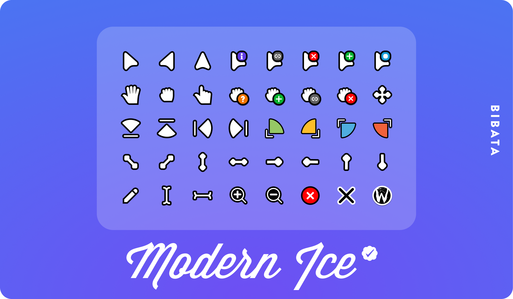

# ArchX13
Documentation for my Thinkpad X13 Gen 1 running Arch Linux.

**Table of Contents**
- [Technical information](#technical-information)
  - [Hardware](#hardware)
  - [Filesystem](#filesystem)
    - [File syncing](#file-syncing)
    - [Backups](#backups)
  - [RAM](#ram)
  - [Security](#security)
  - [Bootloader & Snapshots](#bootloader--snapshots)
- [Programs](#programs)
  - [System](#system)
  - [Default GUIs](#default-guis)
  - [CLI tools](#cli-tools)
  - [Web apps](#web-apps)
- [Shortcuts](#shortcuts)
  - [Navigation](#navigation)
    - [Keyboard](#keyboard)
    - [Mouse](#mouse)
  - [System](#system-1)
  - [Programs](#programs-1)

## Technical information

### Hardware

CPU: i7-10710U @ 1.10GHz

RAM: 16 GB (2x 8 GB Micron DDR4 SODIMM @ 2667 MHz / rated 3200 MHz)

MEMORY: 256GB NVMe (Intel SSDPEKKF256G8L)

---

### Filesystem

I have two block devices:
```
nvme0n1
├─nvme0n1p1   2G        vfat      (unencrypted boot drive)
└─nvme0n1p2   236.5G    btrfs     (encrypted root filesystem)
```

#### btrfs

I have chosen **btrfs** as my filesystem because it supports snapshots, being able to roll back the system is important since Arch is rolling release. 

I use the default **zstd** compression algorithm with the level set to 1 because I have fast nvme memory and I don't want the CPU limiting my read and write speed.  

As a additional flag I have **noatime** because it conflicts with btrfs' Copy-on-Write. 

```
/                   (@)
├── boot            (Boot Drive)
├── home            (@home)
├── var
│   ├── log         (@var_log)
│   ├── tmp         (@var_tmp)
│   └── cache       (@var_cache)
└── .snapshots      (@snapshots)
```

#### encryption

The root directory is encrypted with LUKS2 using cryptsetup.

```
/etc/mkinitcpio.conf
HOOKS=(keyboard ... sd-vconsole. ... sd-encrypt)
```

```
rd.luks.name=XXXXXXXX-XXXX-XXXX-XXXX-XXXXXXXXXXXX=name
rd.luks.options=XXXXXXXX-XXXX-XXXX-XXXX-XXXXXXXXXXXX=tpm2-device=auto
```

systemd-cryptenroll --wipe-slot=tpm2 --tpm2-device=auto \
  --tpm2-pcrs=7+15:sha256=0000000000000000000000000000000000000000000000000000000000000000 \
  /dev/encrypted-device

#### Snapshots

System snapshots are managed with **snapper** and are automatically created with **snap-pac** when updating updating.

Only the root directory is snapshotted and thus important files are [backed up](#file-syncing).

#### Backups

##### File syncing

Specific directories are being synced between my machines using Syncthing.

Syncthing is being ran as a user service. 

##### Cloning

TODO: Set up backups with rclone.

---

### Swap

I've chosen **ZRAM** because it's fast, simple and I don't need hibernation. 

I have used **zram-generator** to set up a device with 8 GiB or **half of my RAM**.

#### Configuration File
`/etc/systemd/zram-generator.conf`

```ini
[zram0]
zram-size = min(ram / 2)
```

---

### Booting & Security

**GRUB2** is the bootloader.

TPM2 and Secure boot are both enabled and the UEFI settings are password protected.

#### GRUB2

GRUB has been initialised with the flags:

TODO

#### Secure boot

Secure boot keys have been created and enrolled with **sbctl** using the microsoft shim. 

Both GRUB and the kernel have been signed:

```
/boot/vmlinuz-linux
/boot/EFI/GRUB/grubx64.efi
```

### Firmware & Services

pipewire pipewire-pulse pipewire-audio pipewire-jack pipewire-alsa

wireplumber

sof-firmware

intel-ucode


#### Networking & Bluetooth


**NetworkManager** is being used with **iwd** as the backend.

TODO mention **systemd-resolved**

A network firewall has been set up by enabling the **firewalld system service**.

**bluez**'s **bluetooth.service** handles bluetooth.

---

### Problems & Shortcomings

The kernel lives on another drive and isn't snapshotted. This can yield two kinds of problems:

1. Newer kernels may break the system and can't be downgraded without booting from a live usb.
2. When rolling back, a later kernel may be incompatible with previous versions of programs.  

Hiberanation is not possible with the current setup. This would require a swap device on the SSD. 

## Theming

### Plymouth

The boot sequence uses plymouth to create a splash screen.

My plymouth theme is the [macOS themed Arch Linux Logo](https://www.gnome-look.org/p/2106821). 


Remember to follow the [installation guide](#theme-installation-guide) for this theme if using cryptsetup!

```
GRUB_TIMEOUT=2
GRUB_CMDLINE_LINUX_DEFAULT="... quiet splash ..."
```

```
/etc/mkinitcpio.conf
HOOKS=(... plymouth ...) # before sd-encrypt
```

#### Theme installation guide

> 1. Download the theme you want.
> 2. Unzip the .zip archive.
> 3. Then open a terminal and run the following command (change the theme name if needed). In this example, we assume that the theme is located in the Downloads directory. If that is not the case, the path should be adjusted. 
>    ```bash
>    sudo cp -r ~/Downloads/arch-mac-style /usr/share/plymouth/themes/
>    ```
> 4. If you are using an encrypted installation, you should replace the "keymap-render.png" file. The image size may vary depending on your system. If you use the existing keymap from my theme, the keyboard layout might not display correctly. Therefore, copy the file from the Spinner theme and paste it into my theme. When using the following command, remember to replace the path (adjust the theme name in the path): 
>    ```bash
>    sudo cp /usr/share/plymouth/themes/spinner/keymap-render.png /usr/share/plymouth/themes/arch-mac-style/images/keymap-render.png
>    ```
> 5. Then run the following command to check whether the theme has been recognized. It should appear in the list:
>    ```bash
>    sudo plymouth-set-default-theme -l
>    ```
> 6. Use the following command to apply the theme. Again, replace the name if you're using a different theme:
>    ```bash
>    sudo plymouth-set-default-theme -R arch-mac-style
>    ```
> 7. Regenerate mkinitcpio: sudo mkinitcpio -P

---

### Cursor

The cursor I am using is called [Bibata Modern Ice](https://www.gnome-look.org/p/1197198).



[**Installation**](https://github.com/ful1e5/Bibata_Cursor#linux-x11wayland)
```
tar -xvf Bibata-Modern-Ice.tar.gz              # extract `Bibata.tar.gz`
mv Bibata-Modern-Ice ~/.local/share/icons/     # Install to local users
sudo mv Bibata-Modern-Ice /usr/share/icons/    # Install to all users
```

Alternatively all bibata cursor themes can be installed from the AUR: `bibata-cursor-theme-bin`. NOTE: this takes up about 10x as much memory (30 Mb vs 300 Mb).

### Fonts

I am using **ttf-jetbrains-mono-nerd** as my main font, it can be found in the Extra repository.

## Programs

TODO: Reflector here or in services?

The Arch User Repository (AUR) has been enabled by installing [Yet another Yogurt](https://github.com/jguer/yay#binary) (yay). 

### System

The default associations are included in `ArchX13/config/mimeapps.list`.

#### Ly

Login manager.

| Attribute | Details |
| :--- | :--- |
| **Source** | `AUR/ly` |

`ly@tty1.service` enabled.

---

#### Niri
Scrollable-tiling compositor.

| Attribute | Details |
| :--- | :--- |
| **Source** | `Extra/niri` |
| **Config Path** | `~/.config/niri/config.kdl` |

---

#### Noctalia
Desktop shell.

| Attribute | Details |
| :--- | :--- |
| **Source** | `Extra/noctalia` |
| **Config Paths** | `~/.config/noctalia/settings.toml`<br>`~/.local/state/noctalia/settings.toml` |

---

### Default GUIs

#### Nautilus

GUI file manager

| Attribute | Details |
| :--- | :--- |
| **Source** | `Extra/nautilus` |

---

#### Yazi

TUI file manager

| Attribute | Details |
| :--- | :--- |
| **Source** | `Extra/yazi` |

---

#### Loupe

Image viewer

| Attribute | Details |
| :--- | :--- |
| **Source** | `Extra/loupe` |

---

#### Papers

Document viewer.

| Attribute | Details |
| :--- | :--- |
| **Source** | `Extra/papers` |

---

#### Foliate

Ebook reader.

| Attribute | Details |
| :--- | :--- |
| **Source** | `Extra/foliate` |

---

#### Logs

System event log viewer.

| Attribute | Details |
| :--- | :--- |
| **Source** | `Extra/gnome-logs` |

---

#### SpeedCrunch

Calculator

| Attribute | Details |
| :--- | :--- |
| **Source** | `Extra/speedcrunch` |

Themed with [my own template](https://github.com/RSKA3/Noctalia-Speedcrunch-Template). TODO: change when noctalia accepts [PR](https://github.com/noctalia-dev/community-templates/pull/156).

#### Authenticator

Generate and store 2FA codes.

| Attribute | Details |
| :--- | :--- |
| **Source** | `Extra/authenticator` |

---

#### Helium Browser

Chromium based web browser.

| Attribute | Details |
| :--- | :--- |
| **Source** | `AUR/helium-browser-bin` |

Helium browser does ship with Digital Rights Management (DRM) software and thus you need to enable it manually:

> **Note: Enabling DRM for Helium Browser**
> 1. Download the latest [Chrome `.deb` package](https://dl.google.com/linux/direct/google-chrome-stable_current_amd64.deb).
> 2. Extract the package:
>    ```bash
>    ar x google-chrome-stable_current_amd64.deb
>    ```
> 3. Extract the tar archive:
>    ```bash
>    tar -xf data.tar.xz -C extracted
>    ```
> 4. Find the Widevine version:
>    ```bash
>    cat extracted/opt/google/chrome/WidevineCdm/manifest.json | grep version
>    ```
> 5. Create the destination directory:
>    ```bash
>    mkdir -p ~/.config/net.imput.helium/WidevineCdm/<Widevine version>
>    ```
> 6. Move the Widevine contents into the created directory:
>    ```bash
>    mv extracted/opt/google/chrome/WidevineCdm ~/.config/net.imput.helium/WidevineCdm/<Widevine version>
>    ```
> 7. Add execution permisions to libwidevinecdm.so:
>    ```bash
>    chmod +x ~/.config/net.imput.helium/WidevineCdm/<Widevine version>/_platform_specific/linux_x64/libwidevinecdm.so
>    ```

**Addons**
```
Ublock origin
Dark reader
Vimium
Proton Pass
```
---

#### Ghostty

Terminal emulator.

| Attribute | Details |
| :--- | :--- |
| **Source** | `Extra/ghostty` |
| **Config Path** | `~/.config/ghostty/config.ghostty` |

---

#### Btop++

Resource Manager.

| Attribute | Details |
| :--- | :--- |
| **Source** | `Extra/btop` |

---

#### ONLYOFFICE

Office Suite.

| Attribute | Details |
| :--- | :--- |
| **Source** | `AUR/onlyoffice-bin` |

---

#### LocalSend

Sharing files over local network.

| Attribute | Details |
| :--- | :--- |
| **Source** | `AUR/localsend-bin` |

To configure localsend with firewalld it requires that you enable the port 53317.

	1. sudo firewall-cmd --permanent --add-port=53317/tcp
	2. sudo firewall-cmd --permanent --add-port=53317/udp
	3. sudo firewall-cmd --reload

---

#### VSCodium

Code editor.

| Attribute | Details |
| :--- | :--- |
| **Source** | `AUR/vscodium-bin` |

Install NoctaliaTheme to enable custom theme.

https://docs.noctalia.dev/noctalia/templates/community/vscode/?section=setup#setup

---

#### Telegram

Instant messaging program.

| Attribute | Details |
| :--- | :--- |
| **Source** | `Extra/telegram-desktop` |

If you want a custom theme you need to follow the instructions [here](https://github.com/Alexandr-Sol/telegram-theme-noctalia#applying-the-theme-in-telegram).
```
1. Open your file manager and find the noctalia.tdesktop-theme file in the hidden ~/.cache/telegram-theme-noctalia/ folder.
2. Drag and drop this file into Telegram (e.g., into "Saved Messages").
3. Click on the sent file directly in the Telegram chat.
4. A theme preview window will appear — click "Apply".
```

---

#### Proton Pass

Password Manager.

| Attribute | Details |
| :--- | :--- |
| **Source** | `AUR/proton-pass-bin` |

---

### CLI tools

#### vim

Text editor.

| Attribute | Details |
| :--- | :--- |
| **Source** | `AUR/vim` |

---

#### Xremap

Key remapper.

| Attribute | Details |
| :--- | :--- |
| **Source** | `AUR/xremap-niri-bin` |
| **Config Path** | `~/.config/xremap/config.yml` |

I have set up xremap to output tab switch keybinds for helium browser due to the fact that neither Firefox nor Chromium browsers allow me to set non-latin keys (like ctrl+ö) to switch tabs.

To configure xremap it requires the user to:

    1. add themselves to the input group: sudo gpasswd -a YOUR_USER input
    2. Give members of the input group permission to make output devices: echo 'KERNEL=="uinput", GROUP="input", TAG+="uaccess", MODE:="0660", OPTIONS+="static_node=uinput"' | sudo tee /etc/udev/rules.d/99-input.rules
    3. Reboot

---


#### GHGrab

Github Grab, select files to pull from repo.

| Attribute | Details |
| :--- | :--- |
| **Source** | `AUR/ghgrab-bin` |

---

#### fzf

Fuzzy find files.

| Attribute | Details |
| :--- | :--- |
| **Source** | `Extra/fzf` |

---

#### lazygit

Git TUI.

| Attribute | Details |
| :--- | :--- |
| **Source** | `Extra/lazygit` |

---


### Web apps

A selection of web apps created with helium browser.

* Spotify
* Youtube
* Gemini
* Moodist

## Shortcuts

`Mod` refers to the windows key.

NOTE: I am using a Finnish keyboard.

### Navigation

#### Keyboard

| Key Binding | Action |
| :--- | :--- |
| `Mod` + `J` | Left |
| `Mod` + `K` | Down |
| `Mod` + `L` | Up |
| `Mod` + `Ö` | Right |
| `Mod` + `1/2/3` | Workspace (1/2/3) |
| `Mod` + `R` | Resize window |
| `Mod` + `F` | Resize fullscreen |
| `Mod` + `Shift` + `F` | Fullscreen |

In addition these most programs can be navigated similarly with `Ctrl` in place of `Mod`.

You can also hold `Shift` down while using these keybinds to move around windows.

#### Mouse

| Key Binding | Action |
| :--- | :--- |
| `Mod` + `ScrollUp` | Left |
| `Mod` + `ScrollDown` | Right |
| `Mod` + `Shift` + `ScrollUp` | Up |
| `Mod` + `Shift` + `ScrollDown` | Down |

### System 

| Key Binding | Action |
| :--- | :--- |
| `Mod` + `D` | Program launcher (Noctalia) |
| `Mod` + `Esc` | Session manager |
| `Mod`/`Ctrl` + `Q` | Quit (Program / Window) |
| `Mod`/`Ctrl` + `T` | New (Terminal / Window) |
| `Mod` + `O` | Overview |
| `Mod` + `H` | Niri Keybinds (Help) |
| `PrtSc` | Screenshot |
| `Shift` + `PrtSc` | Screenshot screen |
| `Alt` + `PrtSc` | Screenshot window |

### Programs
 
| Key Binding | Action |
| :--- | :--- |
| `Mod` + `A` | Authenticator |
| `Mod` + `S` | Localsend (Share) |
| `Mod` + `C` | Calculator (SpeedCrunch) |
| `Mod` + `G` | Gemini (AI) |
| `Mod` + `B` | Helium (Browser) |
| `Mod` + `P` | Proton Pass (Passwords) |
